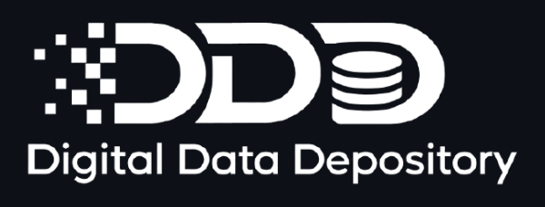
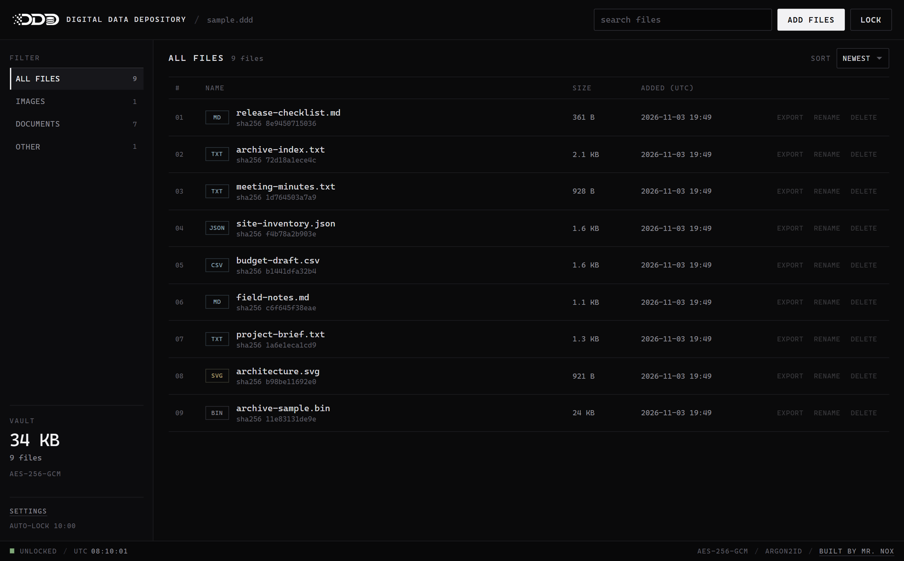
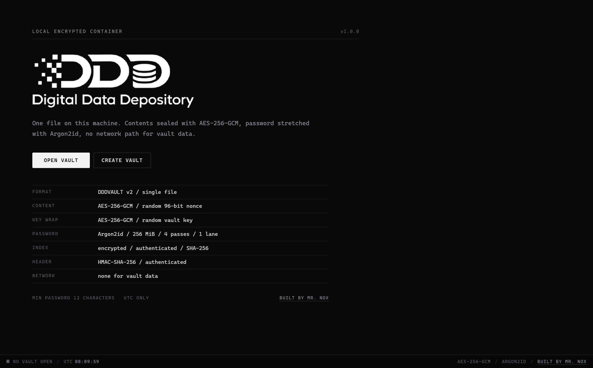
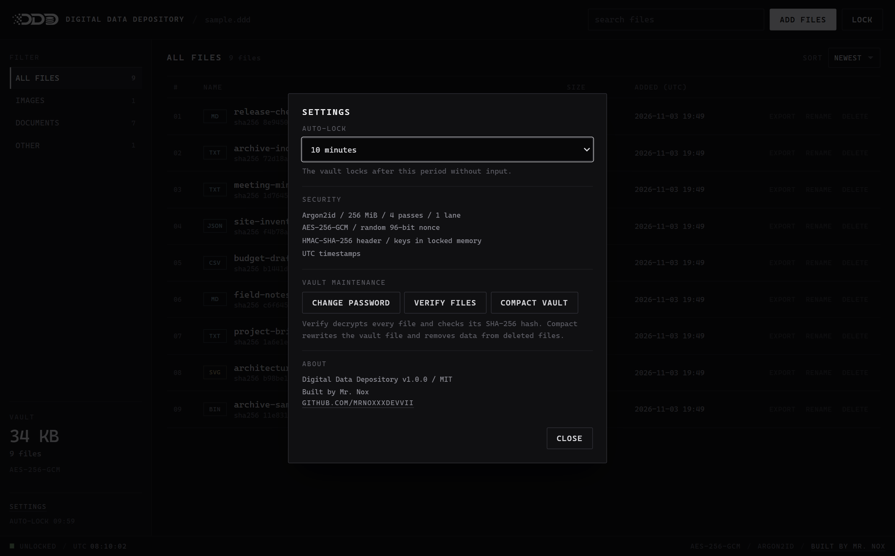

# Digital Data Depository

DDD is a desktop application that keeps files inside one encrypted vault file. You choose the files, you choose the password, and the vault stays on your machine. There is no account, no server and no vault network access.

The application is built with Tauri 2: a Rust backend for the vault engine and a plain HTML, CSS and JavaScript interface rendered by the system webview. Nothing is bundled through npm and there is no frontend build step.



## What it does

- Creates a single `.ddd` vault file that can be moved, copied or backed up like any other file.
- Encrypts every file separately with AES-256-GCM before it touches the disk.
- Derives the key-encryption key from your password with Argon2id.
- Authenticates the header with HMAC-SHA-256, so the key wrap, parameters and index pointers cannot be edited without the vault key.
- Stores the file list (names, sizes, hashes, offsets) inside the encrypted and authenticated index.
- Verifies every file end to end: decrypt, check the authentication tag, then compare the SHA-256 hash.
- Exports a decrypted copy only after that verification passes, and refuses to write over the open vault file.
- Renames and deletes entries, changes the password and compacts the vault.
- Changes the password by generating a new vault key and re-encrypting the whole vault, so the previous password cannot open current data.
- Locks automatically after a period without input, in the interface and in the Rust backend.

## Screenshots

| | |
| --- | --- |
|  |  |

The screenshots use a demo vault with fictional file names and contents.

## Getting started

**Prebuilt executable (Windows)**

Run `DDD.exe` from the project folder. WebView2 is required; it ships with Windows 10 and 11 by default.

**From source**

Prerequisites:

- Rust 1.90 or newer
- Microsoft C++ Build Tools (Desktop development with C++)
- WebView2 runtime

```sh
cd src-tauri
cargo run --release
```

The release binary is written to `src-tauri/target/release/ddd.exe`. The frontend lives in `ui/` and is embedded into the binary at compile time, so the executable does not need the source tree at runtime.

**Tests**

```sh
cd src-tauri
cargo test
```

The test suite covers creation, add and read round trips, wrong passwords, tamper detection, header authentication, rename and delete, password rekeying, rekey nonce rotation, export destination checks and compaction.

## Using the vault

1. **Create vault** asks for a password and a location. The password must have at least 12 characters. It is not stored anywhere.
2. **Open vault** selects an existing `.ddd` file and unlocks it with the password.
3. **Add files** encrypts the selected files and appends them to the vault.
4. **Export** decrypts one file, verifies its SHA-256 hash and writes it to the location you choose. The open vault file is rejected as a destination.
5. **Rename** changes the name in the index. The encrypted content is not touched.
6. **Delete** removes the entry from the index. The encrypted bytes remain in the file until compaction.
7. **Settings → Verify files** decrypts every entry and checks its hash.
8. **Settings → Compact vault** rewrites the vault into a fresh file, re-encrypts every live object with a new nonce and drops data that belongs to deleted entries.
9. **Settings → Change password** creates a new vault key, wraps it under the new password and re-encrypts every object and the index. The old password and the old wrapped key stop working.
10. **Lock** drops the session key and returns to the welcome screen. The same happens automatically after the selected idle period.

## Security design

**Key hierarchy.** The password is never used directly as a cipher key. Argon2id (256 MiB memory, 4 passes, 1 lane, 16-byte random salt) derives a 256-bit key-encryption key. That key wraps a random 256-bit vault key with AES-256-GCM. Opening a vault validates the Argon2id parameters against fixed bounds before deriving, which limits memory exhaustion from a crafted header.

**Encryption.** Every object is encrypted with AES-256-GCM using a fresh random 96-bit nonce. The index is encrypted the same way. A 128-bit authentication tag rejects modified ciphertext before any plaintext is returned.

**Binding.** The key wrap, the index and every object use associated data that includes a random 128-bit vault identifier. Object associated data also includes the entry identifier. The index additionally binds the header generation, index offset and index length. A ciphertext moved to another vault, entry, index position or generation fails authentication.

**Header authentication.** Each header slot carries an HMAC-SHA-256 tag over the format version, generation, KDF parameters, salt, wrapped key, vault identifier and index pointer. The tag key is derived from the vault key, so the header cannot be modified without unlocking the vault. The tag is checked before the index is read.

**Integrity.** Each entry stores the SHA-256 hash of its plaintext. Verification decrypts the object and compares the hash, so corruption that somehow survives the authentication tag is still reported.

**Crash safety.** The header occupies two 2 KiB slots. Each slot stores a generation number, a keyed HMAC-SHA-256 tag and an unkeyed checksum over the header fields. A new index is written first, then the higher-generation header is written to the other slot and flushed. If power is lost at any point, at least one complete header and index pair remains. Rebuilt files write the same authenticated header to both slots.

**Compaction and rekeying.** Compaction rebuilds the vault into a temporary file, copies only the live index entries, re-encrypts every object with a fresh nonce under the current vault key and replaces the original with an atomic rename. Password change performs the same rebuild with a new random vault key and a new Argon2id salt, then swaps the file. The temporary file is created with exclusive access and kept locked across the rename.

**Concurrency.** The vault file is held under an exclusive operating-system lock (Windows `LockFileEx`, Unix `flock`) for the whole session. A second process opening the same file is refused instead of corrupting it.

**Memory.** Keys are stored in a heap allocation protected with `VirtualLock` on Windows or `mlock` on Unix and overwritten with `zeroize` when dropped. Plaintext buffers and index JSON are `Zeroizing` values. Locking the vault drops the session; a backend watchdog drops it as well when the idle limit expires, even if the interface stops sending activity signals. The interface reloads on lock to discard decrypted state held by JavaScript.

**Auto-lock.** The interface refreshes activity on pointer, keyboard and wheel input. Native Open or Save dialogs do not hold the vault open: the timeout keeps counting while a dialog is visible, and the Rust watchdog enforces the same limit independently of webview timers.

**Application surface.** The Tauri configuration allows no shell, filesystem or HTTP plugins. The content security policy restricts scripts and styles to the bundled files, images to the bundle and data URLs, and connections to the local IPC channel. There is no telemetry and no update check. The only outbound action is the fixed author profile link in the interface, opened by the operating system browser through a constant URL in the backend. Vault data never leaves the machine.

### What this does not protect against

- Malware, a keylogger or an attacker with control of the operating system while the vault is unlocked.
- A weak or reused password. Argon2id slows guessing, it does not make a bad password good.
- A lost password. There is no recovery path and no backdoor.
- A complete older copy of the vault file being restored by someone with file access. The app has no external trusted state to detect a whole-file rollback.
- Metadata inside the files you store. Photos and office documents keep their own EXIF or document properties; clean them before adding if that matters.
- Swap or hibernation files, crash dumps and shell history that captured memory or paths while the vault was open.
- Deleted ciphertext that survives in free disk clusters after compaction, because compaction keeps the same vault key. Changing the password generates a new key.
- Plaintext copies you export deliberately.

## Vault file layout

```
offset 0       header slot A (2048 bytes)
offset 2048    header slot B (2048 bytes)
offset 4096    first index / object data
...
end            current encrypted index, followed by appended object data
```

The header holds the magic `DDDVAULT`, format version, generation, Argon2id parameters and salt, the wrapped vault key, the vault identifier, the offset and length of the current index, the HMAC-SHA-256 tag and the slot checksum. Object data is append-only until compaction.

## Project layout

```
ui/                     HTML, CSS, JavaScript and logo assets
src-tauri/src/vault.rs  vault engine, commands and unit tests
src-tauri/src/lib.rs    Tauri setup, idle watchdog and command registration
src-tauri/src/main.rs   entry point
src-tauri/examples/     demo vault generator used for the screenshots
docs/screenshots/       application screenshots
```

## Limits

- 512 MiB per file. Files are encrypted in memory, not streamed.
- 12 characters minimum for the vault password, 1024 bytes maximum (UTF-8).
- The vault file is read and written in place; keep a backup before compacting if the data matters.

## License

MIT. See [LICENSE](LICENSE).

Built by [Mr. Nox](https://github.com/mrnoxxxdevvii). The application uses [Tauri](https://tauri.app/), the RustCrypto crates `aes-gcm`, `argon2` and `sha2`, `zeroize`, `rfd`, `serde`, `uuid`, `rand` and `hex`.
